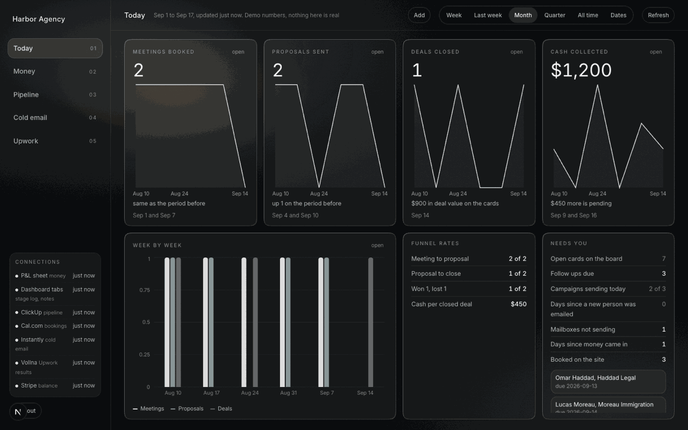

# Solumbra dashboard

A private web page that shows how your agency is doing, from the tools you
already use. Four numbers on top: **meetings booked, proposals sent, deals
closed, cash collected**. Under them, the money, the pipeline, cold email
and Upwork, each on its own page. It reads your Google Sheet, your CRM and
your sending tools every five minutes. Nothing is typed twice.



Built for one person running an agency. No database, no accounts, one
password. Free to run: Vercel's free plan and the tools' own free APIs.

## What it connects to

| What | Where it comes from | Needed? |
|---|---|---|
| Money in, money out, profit, LTV, cost per client | A Google Sheet with a Ledger tab | Yes |
| Meetings, proposals, deals | ClickUp, or a Pipeline tab in the same sheet, or the Add button | One of the three |
| Meetings booked on your site | Cal.com | Optional |
| Cold email: sent, bounces, replies, mailboxes | Instantly | Optional |
| Upwork: viewed, conversations, hired, connects | Vollna | Optional |
| Balance available and pending | Stripe, read only | Optional |

Pages for tools you do not connect are simply not shown.

## Try it in two minutes

You need [Node.js](https://nodejs.org) 20 or newer and [Git](https://git-scm.com). Then, in a terminal:

```bash
git clone https://github.com/nathanael-spec/solumbra-dashboard.git
cd solumbra-dashboard
npm install
npm run demo
```

Open http://localhost:3000. Every number is made up. Click around, open a
tile, change the period. Stop it with Ctrl+C.

## Connect your own business

```bash
npm run setup
```

It asks, in order:

1. Your business name, timezone and currency.
2. **Google.** It walks you through making a service account, a robot Google user, and asks for the JSON file Google gives you. You share your sheet with the robot's email. Five minutes, once.
3. **Where is your P&L?** Paste the link of your sheet. If it has no Ledger tab, setup adds one with the right columns. If you have no P&L at all, make a blank sheet, share it, paste the link.
4. **Where is your pipeline?** ClickUp (it lists your lists and you pick one), a Pipeline tab in the sheet (it makes it), or nowhere yet.
5. Cal.com, Instantly, Vollna, Stripe. Press Enter to skip any of them.
6. Your channels: the ways clients find you.
7. A password.

Every key is tested against the real tool before it is saved. At the end it
reads everything once and prints what came back. Answers are saved to
`.env.local`, which git ignores. Run setup again any time to change something.

The click paths for every key are in [docs/keys.md](docs/keys.md). The sheet
columns are in [docs/sheets.md](docs/sheets.md).

Then:

```bash
npm run dev
```

Open http://localhost:3000 and log in.

## Put it on the web

You want this on your phone, not only on your laptop. Vercel hosts it for free.

1. Make an account at https://vercel.com.
2. `npm install -g vercel`, then `vercel login`.
3. `npm run deploy`

It links the folder to a Vercel project (say yes to the defaults), copies your
keys to that project, deploys, and if your pipeline is ClickUp it creates the
webhook that records every card move. It prints the address at the end.
Run `npm run deploy` again after any change.

## Day to day

- **Add**, top right, records a meeting, a proposal, a deal or a payment that no tool saw. A meeting booked over WhatsApp, cash by bank transfer. Meetings, proposals and deals go to the Stage log tab; cash goes to the Ledger.
- **Week, Last week, Month, Quarter, All time, Dates** change every number on every page at once.
- Every tile opens bigger, with the chart and the rows behind the number.
- **Connections**, bottom left, says when each tool was last read, and shows a tool as failed with the reason on hover.
- Money is only ever counted from the Ledger. Stripe is a balance, not revenue. If it is not in the sheet, it did not happen.

## The rules the numbers follow

- A rate with fewer than 10 in the denominator is shown as "2 of 6", never as a percentage. Upwork rates need 50 applications. Small samples do not get to look like trends.
- The funnel counts the **first** time a card reached a stage, inside the period. Moving a card back and forward does not count twice.
- There is no email open rate anywhere. Open tracking is unreliable and hurts deliverability.
- Cash per closed deal is matched from the Ledger to the won cards by company or name, so it reads what was actually paid, not the deal value on the card.

## Using it with Claude Code

Open the folder in [Claude Code](https://claude.com/claude-code) and say
"help me set this up". `CLAUDE.md` tells it how this project works, what the
numbers mean and how to add a connector for a tool that is not here yet.

## Commands

| Command | What it does |
|---|---|
| `npm run demo` | The dashboard with made up numbers, no login |
| `npm run setup` | The questions. Writes `.env.local`, makes the sheet tabs |
| `npm run setup -- --sheets` | Only add missing tabs to the configured sheets |
| `npm run check` | Read every connected tool once and report |
| `npm run dev` | Run it on your computer |
| `npm run deploy` | Put it on Vercel |
| `npm test` | The metric tests |

## When something is wrong

- **"Google says no (403)"**: the sheet is not shared with the robot's email. Share it as Editor.
- **"Not found (404)"**: the id in `.env.local` is wrong. It is the long part of the sheet's address between `/d/` and `/edit`.
- **A tool shows "failed" in Connections**: hover it for the reason. Usually the key was revoked or the rate limit was hit; the next refresh retries.
- **Meetings show zero but the cards moved**: moves before the webhook existed have no date. Add them once with the Add button.
- **The Upwork page is missing**: Vollna is not connected, or the token failed. `npm run check` says which.

## Privacy

Your keys stay in `.env.local` on your computer and in your own Vercel
project. The page talks only to the tools you connected. Nothing is sent to
the author or to anyone else. It is [MIT licensed](LICENSE): use it, change it,
sell with it.

Made by [Nathanael at Solumbra](https://solumbra.ai), for the Maker School
community. Built with Next.js, Recharts and a lot of Claude Code.
